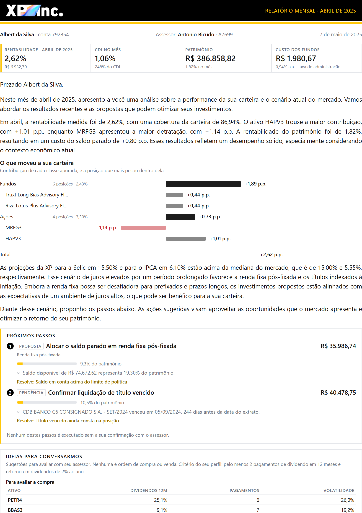
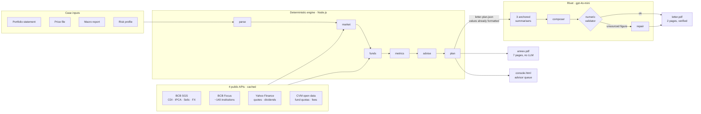

# The letter that doesn't invent numbers

[](https://github.com/felipebgualberto/llm-investment-letter/actions/workflows/test.yml)


A deterministic engine plus an LLM narration layer that writes a monthly investment
letter for a wealth-management client — two pages, in Portuguese, where every figure
is computed, sourced and tested, and the language model is only allowed to write
the sentences around them.

> **Code computes every number. The model only writes sentences.**

Built as a technical case: review and improve a first-version [Rivet](https://rivet.ironcladapp.com/)
workflow that generated the letter with a single LLM prompt.

---

## What it produces

Four case files and four public APIs go in. One command later, out come a client letter, an
advisor annex and a local console.

| In | Out |
|---|---|
| Portfolio statement · price file · macro report · signed risk profile | **`letter.pdf`** — two pages, Portuguese, page count verified from the PDF |
| BCB SGS · BCB Focus · Yahoo Finance · CVM open data | **`annex.pdf`** — seven pages, every finding that didn't fit, no LLM involved |
| | **`console.html`** — the advisor's queue, ordered by money awaiting a decision |



*Page one as generated. Every figure on it — the return, the coverage, the attribution bars,
the amounts in the proposals — was computed by the engine and checked against the payload
before the model was allowed to write a sentence around it. The client is fictional and comes
from the case materials.*

---

## The finding that shaped everything

The first version published these figures. None of them appear in any file the model
was given — and the correct values were in its context the whole time:

| | v1 published | The source document says |
|---|---:|---:|
| Selic 2025 | **9,00%** | 15,50% |
| IPCA 2025 | **4,0%** | 6,1% |
| USD/BRL | **R$ 4,70** | 6,20 |

So I went looking for where those numbers had been true. Pulling the full history from
the Brazilian Central Bank's market-expectations API:

| | v1 published | The Focus survey median was exactly this value on |
|---|---:|---|
| Selic 2025 | 9,00% | **144 survey dates**, from 2023-02-03 to 2024-05-28 |
| IPCA 2025 | 4,00% | **59 survey dates**, up to 2024-10-31 |

Both had stopped being the consensus before the month the letter reports on. By then
the median had nearly doubled, to 15,00%.

The model didn't guess. **It recited the consensus from its own training window while
the right document sat in front of it.** That changes the diagnosis: this is not a prompt
problem, it is an architecture problem. No instruction to "be accurate" fixes a model
that prefers its memory to its context. The only fix is to take the number out of its hands.

The v2 keeps the **same model — `gpt-4o-mini`** — and a test fails the build if any node
uses another. Whatever improved, the architecture improved it.

---

## Architecture



Every stage writes an auditable JSON file, and the next stage reads only that file —
never anyone's memory. The Rivet graph receives a plan with every value already
computed, formatted in Brazilian notation and labelled. **It cannot compute, cannot
choose what to cut, and cannot reach a data source.**

---

## Quick start

```bash
cd solution
npm test          # 213 tests, offline, ~10 s
npm run palette   # WCAG contrast + colour-vision separation, build-blocking
npm run build     # full pipeline, from the checked-in HTTP cache
```

Node ≥ 20. **Zero runtime dependencies** — nothing to install. Every external API
response is cached under `solution/out/cache`, so a second run reproduces every figure
of the first exactly; the only fields that move between runs are build timestamps.
That cache is a correctness feature, not a performance one: a letter
is a document an advisor defends in a meeting weeks later, and an unreproducible number
is an indefensible number. Refreshing is an explicit act (`--refresh`), never a side effect.

---

## What's here

| | |
|---|---|
| [`solution/`](solution/) | The engine, 213 tests, config and tools — start with [its README](solution/README.md) |
| [`solution/out/letter.pdf`](solution/out/letter.pdf) | **The client letter** — two pages, Portuguese |
| [`solution/out/annex.pdf`](solution/out/annex.pdf) | The advisor annex — every finding that didn't fit, no LLM involved |
| [`solution/out/console.html`](solution/out/console.html) | Advisor console: opens by double-click, no server |
| [`letter_workflow_v2.rivet-project`](letter_workflow_v2.rivet-project) | The revised Rivet graph — 33 nodes, generated by code |
| [`docs/RELATORIO.md`](docs/RELATORIO.md) | The two-page report: what was wrong, what I did, what I'd do next (PT-BR) |
| [`docs/DOSSIE-TECNICO.md`](docs/DOSSIE-TECNICO.md) | The long-form technical write-up (PT-BR) |
| [`delivery/`](delivery/) | The submitted reports as `.docx` |
| [`Input/`](Input/) | The case materials exactly as supplied, including the original brief |

---

## What the pipeline found that no input contained

- **Two thirds of the portfolio had no measurable return.** The statement's latest fund
  quota was 398 days old. Resolving each fund to its CNPJ in CVM's open data and reading
  the daily quota series turned **67,71% of the portfolio** from unmeasurable into measured.
  The v1 had filled the hole with an invented "17,4%".
- **The funds cost R$ 1.980,67 a year** (0,94% weighted), read from CVM's fee history —
  a figure no case document mentions.
- **4 of 6 funds beat the benchmark they themselves declared to the regulator.** The other
  two declared none, and the letter says so rather than defaulting them to the CDI.
- **Two of the four stock tickers no longer trade** (ARZZ3 → AZZA3, MRFG3 → MBRF3), and one
  fund had been renamed twice and converted to a FIDC, moving its data to a different dataset.
- **35,8% of the client's equity sleeve fails the very criterion** the letter uses to justify
  buying. The same screen runs in both directions: citing a profile clause only where it
  supports a purchase would be dishonest.
- **R$ 209.224,91 sits under a profile clause no free source can verify** (fixed income rated
  BB+ or better). Reported as a review — never as a breach. *Not checked* is not *non-compliant*.

---

## How the recommendation works

No part of this is the model's judgement. The whole chain is code, and each step is
declared in the letter.

**The universe is closed.** Buy candidates can only come from the tickers XP priced in its
own file — twelve of them. Removing the four the client already holds leaves eight. The
engine is structurally unable to propose a name nobody at the firm put in front of it, which
removes the most dangerous failure mode of an LLM advisor: a confident, well-argued
recommendation to buy something the firm never covered.

**The criterion comes from the client's own signed profile**, which asks for *"ações de
empresas consolidadas com dividendos"*. That prose becomes checkable as two numbers: a
trailing dividend yield of at least 2%, and at least 2 payments in the last 12 months — both
measured from real dividend history, not assumed. One candidate fails (WEGE3, 1,76%).

**Ranking is yield per unit of volatility.** `trailing_dividend_yield ÷ annualised_volatility`,
so a high payer that swings violently does not automatically outrank a steadier one. That
ratio is what "moderate profile" means in a single number.

| | dividend yield | volatility | score |
|---|---:|---:|---:|
| PETR4 | 25,11% | 25,97% | 0,9668 |
| BBAS3 | 9,07% | 19,19% | 0,4727 |
| VALE3 | 9,00% | 25,69% | 0,3502 |

**The cut is disclosed, not hidden.** Policy shows three; the letter states that eight were
considered and seven were eligible. A letter that proposes everything proposes nothing, and
omitting the count would hide the selection.

**The same screen runs backwards.** Applied to what the client already owns, MRFG3 fails
(one payment) and HAPV3 fails (none, zero yield) — together **35,8% of the equity sleeve**.
Citing a profile clause only where it supports a purchase would be dishonest.

**No price is printed.** XP's file marks PETR4 at R$ 37,12 against a market close of
R$ 29,99 — a 23,8% gap, and up to 56% elsewhere. Printing one would mean silently choosing
between two sources that disagree, so the letter says to confirm the source before sizing
an order.

Every suggestion is framed as a candidate for the advisor to evaluate, never as an order,
and that framing is enforced in the prompt and printed in the disclosures.

---

## Decisions worth defending

**Who cuts is a rule, not the model.** The engine produces 27 findings, proposals and
attribution lines; two pages hold a fraction. Handing the model everything with "keep it to
two pages" would let it decide which findings the client never hears — differently on every
run, and untestable. Selection happens in [config](solution/config/suitability-policy.json)
before narration, and what was cut is counted and disclosed.

**Every assumption is declared.** The client's signed risk profile contains *no numbers at
all* — only prose. Every threshold is therefore a house parameter, marked `assumption: true`
in a versioned file. The one exception is CVM's R$ 1M qualified-investor line, marked `false`.

**Resolve values as of the reference date, never the newest row.** One fund publishes a
1,90% fee from 2022 and 2,00% from 2025-06-16. The statement is dated 2025-05-07. Taking the
latest row would print a fee that did not exist in the month being reported — plausible,
wrong, and invisible.

**The custodian is the system of record.** Where the supplied price file and the market
disagree — by up to 71 percentage points, once with opposite signs — the letter discloses the
gap and keeps the custodian's number. The inputs are synthetic, so market data is a second
opinion here, not the truth.

**Errors stop the build.** Renaming one section header in the statement used to produce a
fabricated +3,30% return and exit 0. Now any `severity: "error"` flag aborts with a non-zero
exit. A pipeline that fails loudly beats one that fails plausibly.

**The two-page limit is verified, not estimated.** The build counts page objects inside the
PDF and fails if there are more than two.

---

## Known limits

Stated because they are real, and because a system described without its limits is
described inaccurately.

- **The numeric validator catches 3 of the 7 figures the v1 invented.** It misses the other
  four because each coincides with a number that genuinely exists here: "9%", "4,0%" and
  "3,5%" round to real position weights (8,9977%, 4,0111%, 3,4991%), and "2%" is the policy's
  dividend-yield floor. Value matching cannot tell a hallucinated rate from a real weight that
  rounds the same way. That is a ceiling of the method, not a bug — so the validator is a
  backstop, not the defence. The defence is the architecture upstream.
- **It checks that every number exists, not that it is used correctly.** A letter calling the
  CDI "the portfolio's return" would pass. Fixing that needs each figure stamped with its role.
- **Fund returns assume no mid-month flows.** A time-weighted return chained across cash flows
  needs transaction dates the statement does not carry. The assumption is emitted as a flag.
- **The engine is tested; the prose is not.** An adversarial evaluation set run on every prompt
  change is the first thing I'd build next.

---

## Next steps

In rough priority order. None of it is research — it is known engineering.

1. **Drop the two fragile premises.** In a real deployment the fund's CNPJ arrives with the
   position and all name matching disappears; with current quotas the return becomes a
   time-weighted return chained across cash flows, not the single-month approximation used here.
2. **A risk layer from data already downloaded.** `INF_DIARIO` carries each fund's full daily
   series and this pipeline reads two points of it. The rest gives volatility, drawdown, and the
   fund's percentile inside its own CVM peer group — at zero additional requests.
3. **Close the credit gap.** With a ratings source, the profile's BB+ clause becomes a real
   check — the difference between *not verified* and *compliant*.
4. **Semantic validation.** Stamp every figure with its role and verify the number-label pair,
   not just that the number exists somewhere in the payload.
5. **Continuous evaluation.** An adversarial set — truncated statements, merged funds, months
   with no published IPCA — run on every prompt change.
6. **Operational scale.** A server instead of a local file, authentication, a real audit trail,
   and batch processing with a per-CNPJ cache, since the same funds appear in hundreds of portfolios.

---

## Stack

Node.js (ESM, no dependencies) · `node:test` · Rivet (graph generated programmatically with
`@ironclad/rivet-core`) · hand-written SVG charts · headless Chromium for PDF ·
BCB SGS, BCB Focus, Yahoo Finance and CVM open data.

Prompts, code and the graph are in English. Everything the client reads is in Portuguese.

---

## Disclaimer

This is an educational project, built as a technical exercise. **Nothing in it is investment
advice.** The client, the portfolio and the account are fictional and come from the case
materials; the market data is real and public, but the statement's own marks match no real
trading history, which is exactly why the pipeline treats market data as a second opinion
rather than as truth. The letter it produces is a demonstration of a document pipeline, not
a recommendation to buy or sell anything.

---

<sub>Felipe Bissoli Gualberto · 2026</sub>
